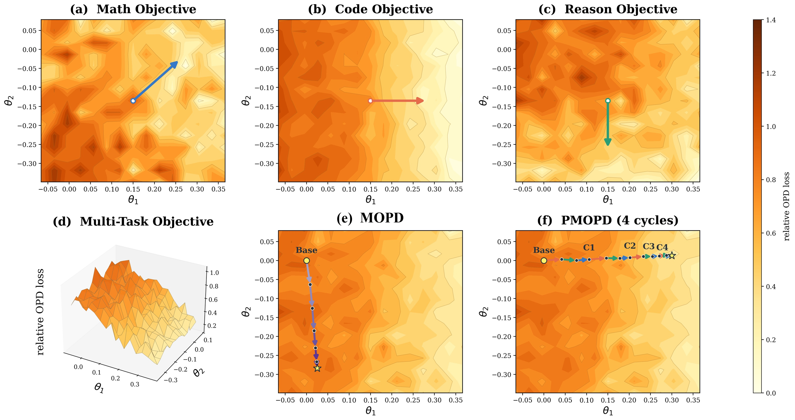

<center>

# PMOPD: Task Ordering, Cycling, and Parameter-Update Subspace Protection in Multi-Teacher On-Policy Distillation

**Youzhi Liu, Ruobing Zheng<sup>*</sup>, Boyuan Tong, Tianqi Li, Pingqi Li, Hanbo Bi, Yi Yuan, Jingdong Chen**

Ant Group

<small>(<sup>*</sup>Corresponding author)</small>

[[📄 Paper](https://arxiv.org/abs/2609.34605)] &nbsp; [[🌐 Project Page](https://digital-avatar.github.io/ai/PMOPD/)] &nbsp; [[🤗 Hugging Face](https://huggingface.co/papers/2609.34605)]

</center>


PMOPD (**Projection-based Multi-Teacher On-Policy Distillation**) integrates multiple specialized teachers into a single language model while reducing cross-task interference. It represents each completed task stage with low-rank parameter-update subspaces and protects those directions during subsequent stages by projecting both gradients and optimizer updates.



This repository provides the training and evaluation code used for the Qwen2.5-7B and Llama-3.1-8B experiments in the paper.

## Repository structure

```text
PMOPD/
├── pmopd/
│   ├── train.py          # PMOPD and baseline training entry point
│   ├── data.py           # training-data loader and validation
│   ├── optimizer.py      # Adafactor and optimizer-update projection
│   └── model_io.py       # student, teacher, and checkpoint loading
├── evaluation/
│   ├── eval_math.py      # math evaluation
│   ├── eval_reason.py    # multiple-choice reasoning evaluation
│   ├── eval_code.py      # code evaluation
│   ├── math_verifier.py
│   └── code_verifier.py
├── scripts/
│   ├── train_qwen25_7b.sh
│   ├── train_llama31_8b.sh
│   └── eval_all.sh
├── data/
│   ├── README.md         # public data format
│   └── example/          # synthetic JSONL examples
├── pyproject.toml
└── requirements.txt
```

## Installation

Python 3.10 or later is recommended.

```bash
git clone <repository-url>
cd PMOPD
python -m venv .venv
source .venv/bin/activate
pip install -U pip
pip install -e .
```

## Data preparation

Training requires one JSONL file for each task:

```text
/path/to/train_data/
├── math.jsonl
├── code.jsonl
└── reason.jsonl
```

Each training example must contain a unique `id` and a plain causal `prompt`:

```json
{"id": "sample-1", "prompt": "..."}
```

See [`data/README.md`](data/README.md) and [`data/example/`](data/example/) for the complete training and evaluation formats. The example files are synthetic and are provided only to document the expected schema.

## Teacher checkpoints

The three task teachers must share the base architecture and tokenizer of the student. Each teacher path can point to either:

- a PEFT LoRA adapter containing `adapter_config.json` and adapter weights; or
- a partial parameter snapshot containing `model.safetensors` with keys matching the base model’s trainable projection matrices.

PMOPD checkpoints are also partial parameter snapshots and must be loaded on top of the same base model.

## Training

The provided launch scripts use four visible GPUs: one for the student and one for each task teacher. The default training batch size is **16**.

### Qwen2.5-7B

```bash
export CUDA_VISIBLE_DEVICES=0,1,2,3
export BASE_MODEL=/path/to/Qwen2.5-7B
export DATA_DIR=/path/to/train_data
export TEACHER_MATH=/path/to/math_teacher
export TEACHER_CODE=/path/to/code_teacher
export TEACHER_REASON=/path/to/reason_teacher
export OUTPUT_DIR=outputs/qwen25_7b_pmopd

bash scripts/train_qwen25_7b.sh
```

### Llama-3.1-8B

```bash
export CUDA_VISIBLE_DEVICES=0,1,2,3
export BASE_MODEL=/path/to/Meta-Llama-3.1-8B
export DATA_DIR=/path/to/train_data
export TEACHER_MATH=/path/to/math_teacher
export TEACHER_CODE=/path/to/code_teacher
export TEACHER_REASON=/path/to/reason_teacher
export OUTPUT_DIR=outputs/llama31_8b_pmopd

bash scripts/train_llama31_8b.sh
```

### Direct invocation

```bash
python -m pmopd.train \
  --mode pmopd \
  --task_order code reason math \
  --cycles 4 --full_data_epoch --epochs 1 \
  --base "$BASE_MODEL" \
  --data_dir "$DATA_DIR" \
  --teacher_math "$TEACHER_MATH" \
  --teacher_code "$TEACHER_CODE" \
  --teacher_reason "$TEACHER_REASON" \
  --output_dir "$OUTPUT_DIR" \
  --gpu 0 --teacher_gpus 1 2 3 \
  --batch 16 --grad_accum 3 --lr 2e-6 \
  --subspace_rank 16 --kl_direction reverse --top_k_loss 256 \
  --max_prompt 768 --max_prompt_code 2048 --max_new 768 \
  --save_all_stages
```

Important arguments:

- `--task_order`: task sequence within each cycle.
- `--cycles`: number of passes over the ordered task stages.
- `--subspace_rank`: number of right-singular directions retained per matrix and task stage.
- `--svd_device`: device used for subspace extraction; `cpu` reduces GPU memory usage.
- `--pmopd_gradient_only`: project gradients but disable optimizer-update projection.
- `--save_all_stages`: save a checkpoint after every task stage.

Run the following command for the complete argument list:

```bash
python -m pmopd.train --help
```

## Evaluation

Evaluate a single task by running its evaluator directly:

```bash
python evaluation/eval_math.py \
  --model "$BASE_MODEL" \
  --override "$OUTPUT_DIR/final" \
  --data /path/to/eval_data/math.jsonl \
  --output results/math.jsonl \
  --gpu 0
```

To evaluate Math, Reason, and Code sequentially:

```bash
export BASE_MODEL=/path/to/base_model
export CHECKPOINT="$OUTPUT_DIR/final"
export EVAL_DATA_DIR=/path/to/eval_data
export EVAL_OUTPUT_DIR=results/final
export GPU=0

bash scripts/eval_all.sh
```

The evaluators support resuming from existing per-example JSONL outputs and write a separate summary file after evaluation.

## Citation

If you find this repository useful, please cite:

```bibtex
@article{liu2026pmopd,
  title   = {PMOPD: Task Ordering, Cycling, and Parameter-Update Subspace Protection in Multi-Teacher On-Policy Distillation},
  author  = {Liu, Youzhi and Zheng, Ruobing and Tong, Boyuan and Li, Tianqi and Li, Pingqi and Bi, Hanbo and Yuan, Yi and Chen, Jingdong},
  journal = {arXiv preprint arXiv:2609.34605},
  year    = {2026}
}
```

## License

This repository is released under the Apache-2.0 license as found in the [LICENSE](LICENSE) file.
